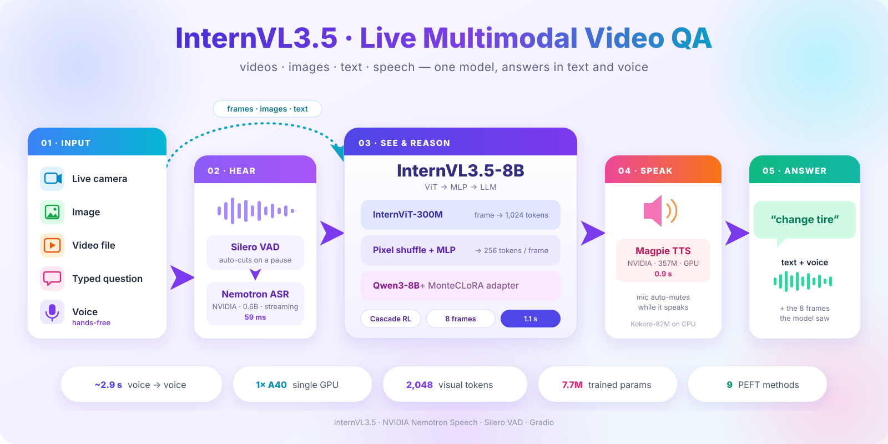
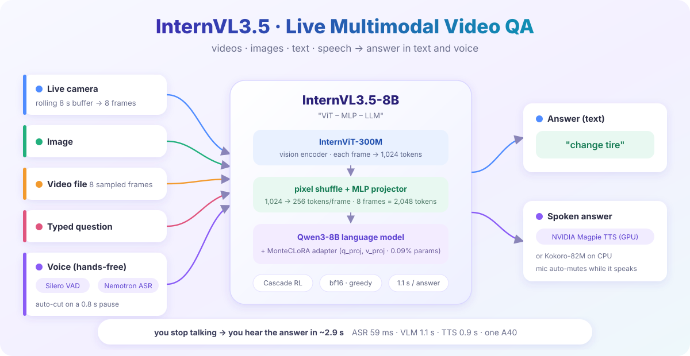

# InternVL3.5 · Live Multimodal Video QA

**Point a camera, ask out loud, hear the answer.** A real-time assistant that understands
**videos, images, text and speech**, built on **InternVL3.5-8B** and **NVIDIA Nemotron Speech**,
running entirely on a single GPU.

<p align="center">
  
</p>

## What it does

- **Live camera as video.** A rolling buffer keeps the last 8 seconds of webcam frames. When you
  ask, it samples 8 frames across that window with the same rule the model was fine-tuned with.
- **Hands-free voice.** Click the mic once, then just talk. Silero VAD detects when you stop,
  Nemotron ASR transcribes, and the answer is spoken back. The mic **auto-mutes while the
  assistant speaks**, so it never answers its own voice.
- **Images and video files**, or plain typed questions, through the same pipeline.
- **Shows its work:** the UI displays the exact 8 frames the model saw and the latency of every
  stage.

<!-- Demo screenshot: save it as images/demo.png and uncomment:
<p align="center"></p>
-->

## Architecture in detail

<p align="center">
  
</p>

| Stage | Model | Role | Latency (A40) |
|---|---|---|---|
| Voice activity | [Silero VAD](https://github.com/snakers4/silero-vad) | cuts the utterance on a 0.8 s pause | 4 ms / 32 ms window |
| Speech → text | [Nemotron ASR 0.6B](https://huggingface.co/nvidia/nemotron-speech-streaming-en-0.6b) | English transcription, native punctuation | **59 ms** |
| Vision + language | [InternVL3.5-8B](https://huggingface.co/OpenGVLab/InternVL3_5-8B) + MonteCLoRA | answers about 8 frames / an image | **1.1 s** |
| Text → speech | [Magpie TTS 357M](https://huggingface.co/nvidia/magpie_tts_multilingual_357m) (or Kokoro-82M on CPU) | speaks the answer | **0.9 s** (short answer) |

From the moment you stop talking, you hear the answer in **~2.9 s**: 0.8 s to confirm you
finished, then ~2.1 s of compute. All four models together peak at **~35 GB** of GPU memory.

### Why these models

- **InternVL3.5** follows the **"ViT–MLP–LLM"** design. InternViT-300M encodes each frame into
  1,024 tokens, pixel shuffle and an MLP projector compress them to 256 tokens and map them into
  **Qwen3-8B**. Post-training uses **Cascade RL**: offline RL (MPO) as a stable warm-up, then
  online RL (GSPO) to raise the ceiling. For serving, **Decoupled Vision-Language Deployment
  (DvD)** places the vision encoder and the LLM on separate servers in an asynchronous pipeline,
  so encoding overlaps decoding. ([paper](https://arxiv.org/abs/2508.18265))
- **Nemotron ASR** is a cache-aware FastConformer + RNNT model built for streaming. A single
  setting (`att_context_size`) trades latency for accuracy, from 80 ms to 1.12 s chunks. This app
  transcribes whole utterances at the most accurate setting.
- **Magpie TTS** keeps the speech stack in NVIDIA's Nemotron Speech family and runs on the same GPU.

## Quick start

```bash
git clone https://github.com/Harihara-Valliappan/Multimodal_QA_bot.git
cd Multimodal_QA_bot

# 1. app environment (kept separate from training, so NeMo can't alter it)
python3 -m venv .venv-app
.venv-app/bin/pip install torch==2.8.0 torchvision==0.23.0 torchaudio==2.8.0 \
    --index-url https://download.pytorch.org/whl/cu128
.venv-app/bin/pip install -r requirements-app.txt

# 2. models: InternVL3.5, Nemotron ASR, Magpie TTS (Hugging Face) + Kokoro (optional)
.venv-app/bin/python scripts/download_models.py

# 3. run (the MonteCLoRA adapter ships in adapters/monteclora)
.venv-app/bin/python scripts/run_app.py                 # Magpie TTS, hands-free voice
.venv-app/bin/python scripts/run_app.py --tts kokoro    # fastest speech, CPU TTS
.venv-app/bin/python scripts/run_app.py --push-to-talk  # no VAD
.venv-app/bin/python scripts/run_app.py --adapter none  # base InternVL3.5, fuller answers
```

Open **http://localhost:7860** and allow camera and microphone access. Browsers grant those
only to `localhost` or HTTPS origins.

**On a Slurm cluster:** `sbatch slurm/05_app.sbatch` from the repo root. The job log prints the
SSH tunnel command. When the app listens on the node's network interface it refuses to start
without a password (generated into `~/.config/videoqa-app/auth`). Partition and module names in
`slurm/*.sbatch` are cluster-specific; adjust them for yours.

> Tip: use headphones. The mic mutes while the answer plays, but headphones also stop the room
> echo from reaching the mic.

## Project structure

```
src/videoqa/
  app/                 live assistant
    assistant.py         MultimodalAssistant: orchestrates visual input + question -> reply
    vad.py               SileroVAD + Endpointer (hands-free utterance detection, echo mute)
    asr.py  tts.py       SpeechRecognizer / SpeechSynthesizer interfaces + Nemotron, Magpie, Kokoro
    vlm.py               VideoQAModel interface + InternVL3.5 (+ adapter) + stub for UI tests
    frames.py            FrameBuffer: live camera -> training-consistent 8-frame clip
    ui.py  config.py     Gradio front end (layout only) · typed AppConfig
  data/ models/ training/ evaluation/   fine-tuning + evaluation pipeline
adapters/monteclora/   the fine-tuned MonteCLoRA adapter used by the app (30 MB)
scripts/               entry points: run_app.py, download_models.py, run_training.py, ...
configs/               one YAML per experiment arm
slurm/                 batch jobs: env audit, eval, smoke test, train, app
tests/                 unit + integration tests (no GPU needed)
docs/                  data sourcing, baseline analysis, DoRA verification
images/                README figures (hero.svg, architecture.svg + PNG copies)
```

```bash
.venv-app/bin/python -m pytest tests/test_app_*.py   # app tests: VAD, assistant, frames, CLI
.venv/bin/python -m pytest tests/                    # training / evaluation tests
```

## Engineering notes

- **CPU thread oversubscription.** On the GPU node, TTS was ~10× slower than expected
  (9.6 s vs 0.9 s). ONNX Runtime sized its pool from the machine's 52 physical cores, while
  Slurm gave the job 8. Sizing it from the job's CPU affinity fixed it.
  ([benchmark](scripts/bench_tts_threads.py))
- **Cold starts.** First calls are slow (ASR 25.9 s → 0.06 s once warm), so every model is
  warmed up at launch.
- **Echo.** In hands-free mode, the assistant would hear its own answer and treat it as a new
  question. The endpointer is muted for the answer's duration plus a margin.
- **Same preprocessing everywhere.** The live app reuses the exact frame sampling, transforms
  and prompt from training and evaluation, so the model sees what it was tuned on.

## Fine-tuning results

The deployed adapter comes from a controlled comparison of parameter-efficient fine-tuning
methods on ActivityNet-QA. Same data, seed, schedule and rank (r=16 on `q_proj`/`v_proj`), scored
on the same **1,090 held-out test questions**:

| Model | Accuracy (normalized) | Exact match |
|---|---|---|
| InternVL3.5-8B, no fine-tuning | 42.8% | 18.3% |
| + LoRA | 45.5% | 45.5% |
| + **MonteCLoRA** | **46.0%** | **46.0%** |

**MonteCLoRA** is a Bayesian take on LoRA. It learns a distribution over the adapter's
down-projection and averages Monte Carlo samples during training, which regularizes the update
and adds no cost at inference. Here it gave the most reliable gain over the base model
(+3.2 points, McNemar p = 0.002) and edged out plain LoRA. That edge is within run-to-run noise.

<sub>Splits are carved from ActivityNet-QA's test videos (the training videos aren't publicly
mirrored), disjoint by video, so results aren't comparable to published leaderboards. Most of
the exact-match jump is the model learning the dataset's answer style; the normalized column is
the fairer comparison. Details in [docs/](docs/).</sub>
